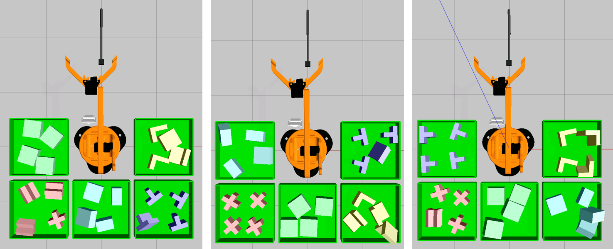
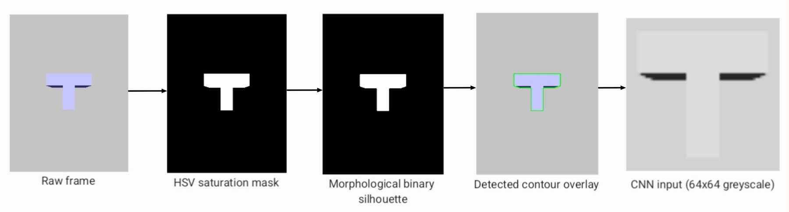
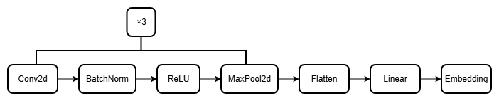

# Automated Robotic Pick and Place

**A fully autonomous 4-DOF robot arm that detects, classifies and sorts objects by shape, built in simulation with ROS 2, MoveIt 2, Gazebo, PyTorch and OpenCV.**

*Source code is private and available on request.*

Final state after three separate 20-cycle runs. Every shape type ends up grouped in its own container.

---

## Overview

Industrial pick and place systems often combine heavy deep learning detectors such as YOLO with hybrid Cartesian and joint-space trajectory planning. Many real setups, like conveyor belts, are much simpler: one object at a time, at a known position, against a plain background.

This project tests whether a **lighter pipeline is enough** for that kind of controlled environment:

- **Vision:** contour detection to find the object, then a CNN embedding to identify its shape
- **Motion:** a 4-DOF arm with joint-space planning through MoveIt 2 and OMPL
- **Control:** a ROS 2 state machine that runs the full sort cycle with no human input

## Results

Evaluated over **three full 20-cycle runs** with five shape types (T, L, cross, square, rectangle).

| Metric | Result |
|---|---|
| Contour detection rate | **100%** (500 of 500 frames across all five shapes) |
| Classification consistency | **No misclassifications**, every shape routed to the same container in every run |
| Motion planning | **Zero planning failures**, all 100 planned moves per run succeeded first time |
| Grasp and transport success | **100%** of objects delivered to the correct container (target was 80%) |
| Autonomy | **20 of 20 cycles** completed with no manual intervention, in every run |

Additional findings:

- **Tested before integration:** on 10 Quick Draw shape categories the CNN never saw in training, different shapes ended up **2.85×** further apart than copies of the same shape, showing it could clearly tell them apart.
- **Consensus filter:** every shape reached agreement in the minimum 3 frames, so the classifier was stable from the very first frame.
- **Planning times:** average plan and execute time per move ranged from **0.8 s** (look pose) to **3.7 s** (return home), all well within the 10 s timeout.

## How it works

### 1. Simulation world

- The arm sits at the centre of a flat ground plane, with **five fixed sorting containers** around it.
- Objects are **spawned one at a time** at a fixed pickup point, which mimics the end of a conveyor belt.
- An **overhead camera on a static stand** watches the pickup point, so detection can run while the arm is still moving.

### 2. Vision pipeline

1. **Saturation mask:** each frame is converted to HSV. The grey floor has almost zero saturation, so the coloured object separates cleanly from the background.
2. **Clean up:** morphological opening and closing remove noise and fill holes.
3. **Contour and bounding box:** OpenCV finds the object outline and crops it.
4. **CNN embedding:** the crop is turned into a **256-dimensional shape embedding**.
5. **Shape matching:** the embedding is compared to stored references using cosine similarity. An **aspect ratio penalty** separates look-alike shapes such as squares and rectangles.
6. **Consensus filter:** three consecutive frames must agree before a result is published.
7. **Dynamic sorting:** each new shape is assigned the next free container, so the system needs no prior knowledge of which shapes will appear.

### 3. CNN embedding model

- Three convolutional blocks (Conv2d, BatchNorm, ReLU, MaxPool), then a fully connected layer with dropout
- Trained on the **Google Quick Draw** sketch dataset
- The penultimate layer is used as an embedding instead of the class output, so the model works on shapes it was **not trained on**
- Stored reference embeddings are updated with a running average each time a shape is matched

### 4. Motion planning and control

- **MoveIt 2 with OMPL** as the planner, set through the MoveGroup interface. CHOMP was also tested but was unstable.
- A **ROS 2 finite state machine** runs each cycle:
  `LOOK_POSE → VISION → OPEN_GRIP → PICK_POSE → CLOSE_GRIP → LOOK_POSE → CONTAINER → DROP → LOOK_POSE`
- Joint limits and a home pose are defined in the MoveIt configuration, so every cycle starts from a known state.

### 5. Grasping

Physics-based grasping in Gazebo is known to be unreliable, since objects can slip even with enough grip force. The **IFRA LinkAttacher** plugin creates a fixed joint between the gripper and the object when the gripper closes, and releases it at the drop. This is a simulation workaround, noted under limitations below.

## Tech stack

| Area | Tools |
|---|---|
| Robotics | ROS 2, MoveIt 2, OMPL, Gazebo, URDF/Xacro |
| Vision and ML | Python, OpenCV, PyTorch |
| Environment | VS Code Dev Container (Linux), colcon, Git |
| Modelling | Blender |

## Limitations and next steps

All results come from simulation. Moving to a real robot would need:

- Real friction-based grasping in place of the LinkAttacher plugin
- A vision pipeline tuned for real camera noise and changing lighting
- Handling the natural variation in where objects arrive on a real conveyor belt

## Acknowledgements

- 4-DOF arm model: [AmeyaB2005/4DOF_Robotic_Arm_In_Gazebo_With_Moveit2](https://github.com/AmeyaB2005/4DOF_Robotic_Arm_In_Gazebo_With_Moveit2)
- Grasping plugin: [IFRA-Cranfield/IFRA_LinkAttacher](https://github.com/IFRA-Cranfield/IFRA_LinkAttacher)
- Training data: [Google Quick, Draw! Dataset](https://github.com/googlecreativelab/quickdraw-dataset)
